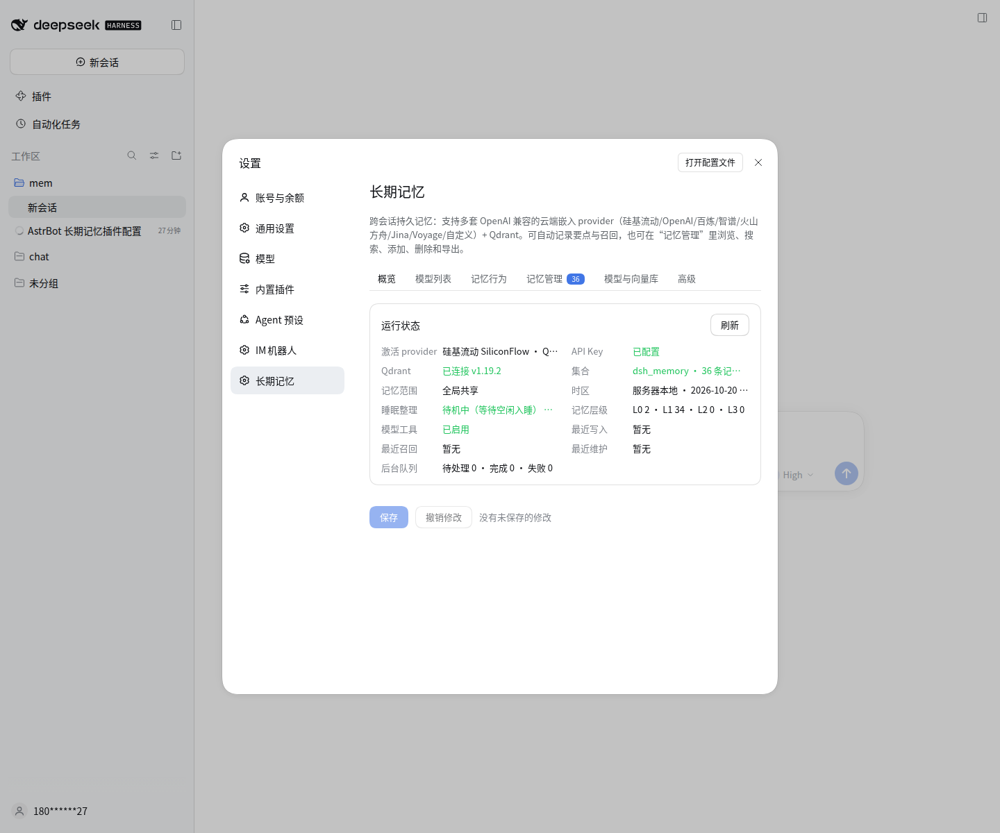
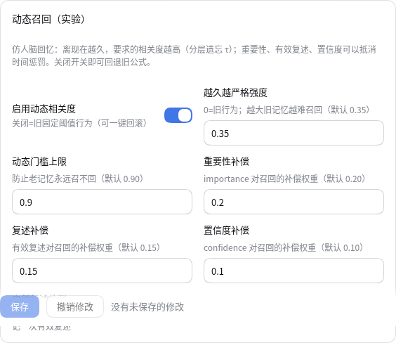
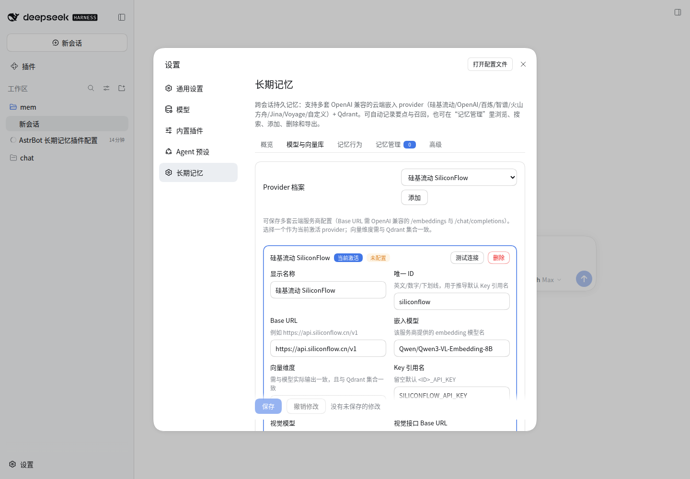
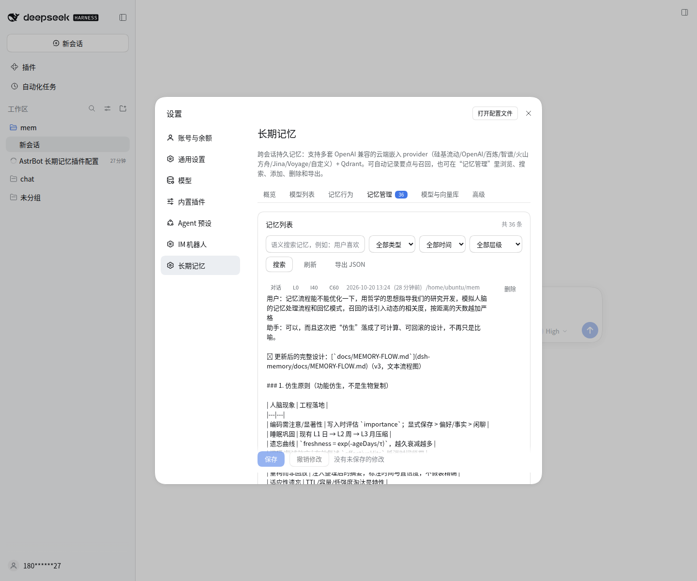
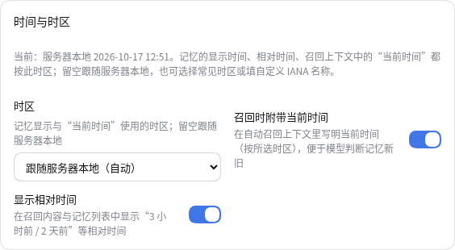
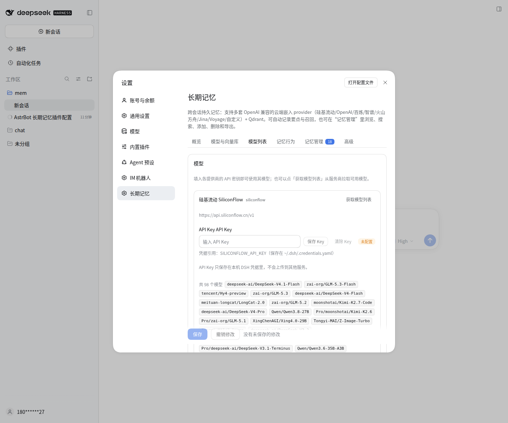
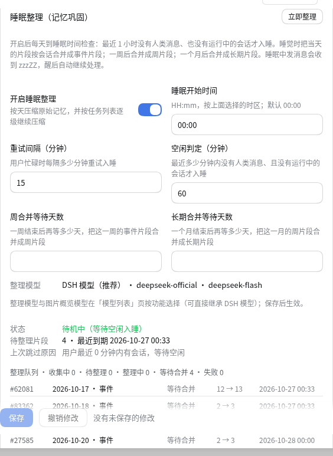
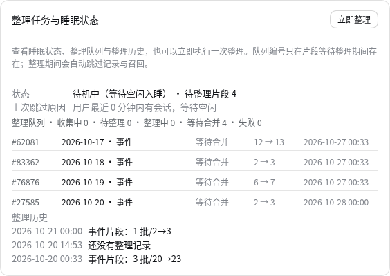
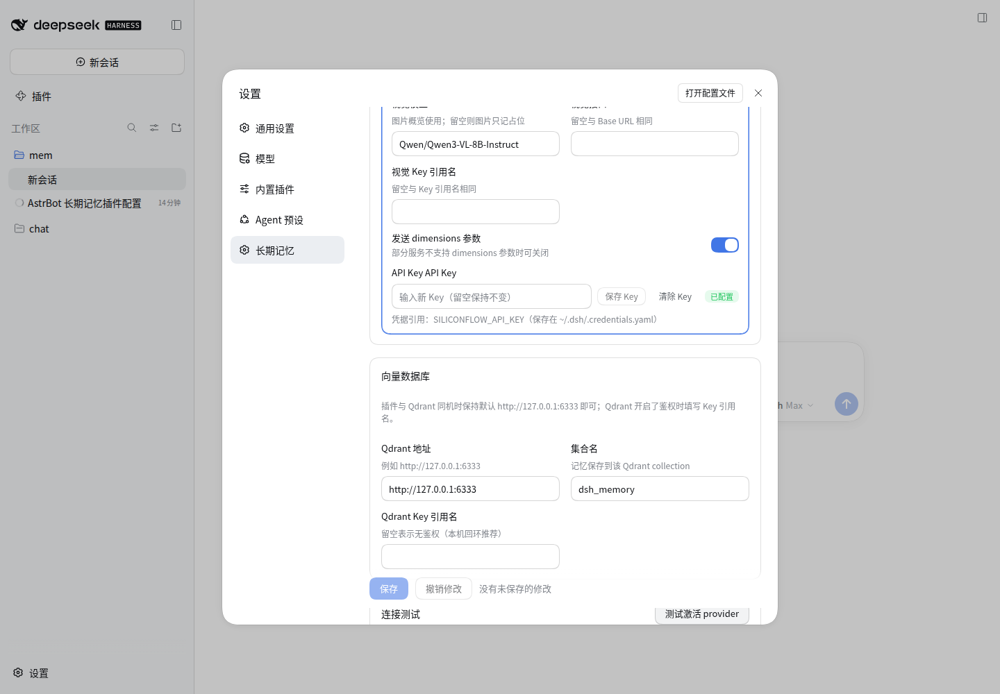

# dsh-memory — DSH 长期记忆插件

[DeepSeek Harness (DSH)](https://github.com/deepseek-ai/deepseek-harness) 的持久化长期记忆插件：
**多套 OpenAI 兼容云端嵌入 provider + Qdrant 向量库**，自动记录对话要点、自动召回相关记忆，
并提供 `memory_search` / `memory_save` / `memory_forget` 工具与完整的设置页 GUI。

纯 JavaScript，无构建依赖（Host 半用 `build.mjs` 拼成单文件），唯一运行时依赖是 DSH 自带的
`@deepseek-ai/schemastery`。



## 功能

- **多 provider 档案**：可保存多套云端服务商配置并随时切换激活项，不再绑定硅基流动。
  内置预设：硅基流动、OpenAI、阿里云百炼（DashScope 兼容模式）、智谱 BigModel、火山方舟 Ark、
  Jina AI、Voyage AI、自定义 OpenAI 兼容服务。
  每个 provider 独立配置：Base URL、嵌入模型、向量维度、Key 引用名、是否发送 `dimensions`、
  视觉模型（用于图片概览）、视觉接口 Base URL / Key 引用名。
- **设置页直接填 API Key**：Key 写入 DSH 凭据库（`~/.dsh/.credentials.yaml`），
  不写进插件配置文件，也不会回传到浏览器；支持按 provider 设置/清除、状态徽标。
- **自动记录**：每轮对话结束后，把「用户要点 + 助手回答要点」写入 Qdrant（不额外调用大模型）；
  可按 `captureMinChars` 过滤“好的/谢谢”之类噪音。
- **图片记忆**：用户发图时调用 provider 的视觉模型生成**一句话概览**，只存这句话 + 向量，
  **永不保存原图**；也支持只记占位或完全忽略图片。
- **自动召回**：每轮第一步检索相关历史记忆，以 `source=long-term-memory` 的上下文行注入
  （DSH 会渲染为“上下文注入”，不是用户气泡）；可配置条数、最低相关度、字符上限、超时、是否包含当前会话。
- **记忆范围**：`global` 全局共享 / `workspace` 按工作目录隔离 / `session` 按会话隔离。
- **记忆管理**：设置页里语义搜索、按时间浏览、手动添加、删除、导出 JSON、重建集合。
- **定期维护**：按间隔自动执行（也可点「立即维护」）：
  清理超过保留天数的记忆、淘汰超出条数上限的最旧记忆、合并高度相似的重复记忆、重建 payload 索引。
- **睡眠整理 / 记忆巩固（可开关）**：默认每天 00:00（按所选时区）检查，最近 1 小时无人类消息且无运行中会话才“睡觉”；
  原始记忆按天压缩成批次（随机 5 位编号 + 任务列表），之后按 7/30 天逐级继续压缩，**默认不限制每级保留条数，由整理模型按内容重要性决定**；
  可选开关才会启用内部上限（L1 40 / L2 20 / L3 10 条）。删除原文只保留整理产物；睡眠期间用户发消息会收到 `zzzZZ`，醒后自动继续处理；支持手动立即整理与整理历史。
- **直接复用 DSH 模型（v0.6，推荐）**：独立「模型列表」页直接读取 DSH「设置 → 模型」里已配置的供应商与模型，
  为「记忆整理」「图片概览」等功能选择模型即可（Key 由 DSH 统一管理，无需重复填写）；也可切到自定义 provider 作为回退。
  嵌入模型 DSH 未提供 embedding 接口，仍由插件自己的 provider 配置（用于 Qdrant 向量维度）。
- **实验功能（默认关闭）**：①跨天相似事件合并（只把相关小簇交给模型，不塞整库）；②增强记忆（1 级产物保留若干天，仅事件/按需召回，到期删除）。


- **动态相关度召回（v0.7，实验，可一键回退）**：仿人脑回忆——记忆越久，要求的相关度越高（分层遗忘 τ：原始 7 天/日摘要 30 天/周 180 天/长期 365 天）；
  重要性、有效复述、置信度可以抵消时间惩罚；被召回的记忆带时间/相对年龄/置信度注入。默认开启，设置页可关闭回退旧公式。
- **复述分类（v0.7）**：被动曝光只记录、不强化；主动检索/自然复述/用户确认/纠正分别按权重计入有效复述；纠正会降低置信度并标记待再巩固。
- **时间与时区（v0.3）**：时间戳按 epoch 存储，显示时使用你选择的时区（默认跟随服务器本地）。
  自动召回上下文会附带「当前时间（含时区）」与每条记忆的相对时间（如“3 天前”），方便模型判断新旧；
  记忆管理页支持按「今天 / 近 7 天 / 近 30 天」筛选。
- **模型工具**：`memory_search` / `memory_save` / `memory_forget`，可在设置页一键禁用；
  写入前自动脱敏（`sk-…`、`Bearer …`、`api_key: …`、`password: …` 等）。

| Provider 档案 | 记忆管理 |
|---|---|
|  |  |

## 安装

### 方式一：从 GitHub 安装（推荐）

```sh
dsh plugin --profile web add github:krutziy/dsh-memory
```

装好后刷新浏览器页面，进入 **设置 → 长期记忆** 配置 provider 与 API Key。

### 方式二：本地目录安装（开发）

```sh
dsh plugin --profile web add /absolute/path/to/dsh-memory
```

新装插件通常由 DSH 的 HMR 直接激活；浏览器端设置页需要刷新一次页面。

## 配置说明

设置页分为五个 Tab：

### 概览
显示当前激活 provider、API Key 状态、Qdrant 连接与版本、集合条数/维度、记忆范围、工具开关、
最近写入/召回、最近维护结果、后台队列。

### 模型与向量库

| 配置 | 说明 |
|---|---|
| Provider 档案 | 多套服务商配置，选择一个「当前激活」。切换后新写入/检索立即使用新 provider |
| Base URL | 需支持 OpenAI 兼容的 `POST /embeddings`（以及视觉概览用的 `/chat/completions`） |
| 嵌入模型 | 该服务商的 embedding 模型名 |
| 向量维度 | 必须与模型实际输出一致，并与 Qdrant 集合一致；改维度后需「重建集合」 |
| Key 引用名 | 凭据在 DSH 凭据库中的引用名，留空默认 `<ID>_API_KEY`；设置页下方直接填 Key |
| 视觉模型 | 图片概览使用的多模态模型；留空则图片只记占位 |
| 发送 dimensions | 部分服务不支持 `dimensions` 参数时关闭 |
| Qdrant 地址/集合 | 默认 `http://127.0.0.1:6333` / `dsh_memory`；Qdrant 有鉴权时填 Key 引用名 |

### 记忆行为
记忆范围、自动记录/召回开关、召回条数/相关度/字符上限/超时、图片记忆方式与提示词、工具开关与默认条数。

### 时间与时区
| 配置 | 默认 | 说明 |
|---|---|---|
| 时区 | 跟随服务器本地 | 记忆显示时间、相对时间、召回上下文里的“当前时间”都按该时区；提供常见 IANA 时区下拉，也支持填自定义 IANA 名称 |
| 召回时附带当前时间 | 开 | 自动召回时在上下文里写明当前时间（含时区），便于模型判断记忆新旧 |
| 显示相对时间 | 开 | 在召回内容与记忆列表中显示“3 小时前 / 2 天前” |



### 模型列表与功能模型分配



- 「模型列表」页直接读取 **DSH「设置 → 模型」** 里已配置的供应商与模型（例如 `deepseek-official / deepseek-flash`），
  不需要在本插件里重复填 Key；DSH 默认模型会显示出来，留空即跟随默认模型。
- 「功能模型分配」为 **记忆整理**、**图片概览** 分别选择模型：
  - 默认来源 `DSH 模型`：直接用 DSH 已配置的模型（图片概览需选择声明支持图片输入的模型）；
  - 也可切换为 `自定义 provider`：使用本插件「模型与向量库」里的 provider 与 Key 作为回退。
- **嵌入模型** 无法从 DSH 读取（DSH 只提供对话/图片 LLM，没有 embedding 接口），
  仍由插件自己的 provider 配置决定，并决定 Qdrant 集合维度。
- 「限制每级整理条数」开关默认关闭；关闭时保留条数由整理模型自行决定，开启后才套用内部上限 40/20/10。

### 睡眠整理与清理维护





- **任务列表**：每个整理批次随机分配一个 5 位编号，任务列表保存在 `$DSH_HOME/storages/dsh-memory/consolidation.json`；
  编号只要求“待处理/处理中”批次唯一，批次完成后编号可回收复用。
- **压缩链**：原始记忆（L0）按天压缩为 L1 批次 → 7 天后压缩为 L2 → 30 天后压缩为 L3；
  默认不限制每级保留条数（由整理模型按内容重要性决定，可选开关启用 40/20/10 上限），原文在整理成功后删除（失败/超时会保留原文下次重试）。
- **睡眠状态**：设置页与记忆管理页可查看“待机中/睡觉整理中”、待处理批次、最近整理与历史；支持手动「立即整理」。
- **整理模型**：在「模型列表 → 功能模型分配」里选择 provider 与模型（默认 `Qwen/Qwen2.5-7B-Instruct`），模型不可用时自动回退纯规则压缩。

### 记忆管理
记忆列表（语义搜索/时间筛选/分页/删除）、手动添加、导出 JSON、定期维护与保留策略、重建集合。

### 高级
记录时的用户/助手内容截断字符、最短记录字符、是否记录子代理会话、调试日志。

## 数据与安全

- Qdrant 中每条记忆只包含：脱敏后的文本要点、类型、时间、会话 id、工作目录、provider、向量。
  图片只保留概览与宽高/格式，**不保存图片字节**。
- API Key 保存在 `~/.dsh/.credentials.yaml`（`refs` 映射），不进入插件配置/profile patch。
- DSH 自己的会话日志本来就会保存聊天图片附件，这与本插件无关。
- 建议 Qdrant 只监听 `127.0.0.1`；如需远程访问请配置 API Key 与安全组，不要直接暴露公网。
- 插件不会回填历史会话；从安装后开始记录。

## 开发与热重载

- 源码：`src/index.js`（Host 入口）、`src/lib/*.js`（各模块）；`client.js` 是浏览器设置页（单文件，无构建）。
- DSH 的 HMR 在 Node 26 下只刷新入口模块，因此 Host 半用构建脚本拼成无本地 import 的单文件 `index.js`：

  ```sh
  node build.mjs
  ```

  写回 `index.js` 后，若 profile 里开启了 HMR 模块监听，会自动重载插件，无需重启 dsh：
  在 `~/.dsh/profiles/web/cordis.patch.yml` 里加入：

  ```yaml
  - id: hmr
    name: "@deepseek-ai/dsh-hmr"
    config:
      base: "/"
      root:
        - home/ubuntu/mem/dsh-memory
  ```

  修改 `client.js` 后刷新浏览器一次即可。

## 本地 HTTP 接口（设置页同源，仅供排查/扩展）

| 方法 | 路径 | 说明 |
|---|---|---|
| GET | `/__dsh_memory__/status` | 运行状态 |
| GET | `/__dsh_memory__/memories?q=&limit=&offset=&kind=` | 记忆列表/语义搜索 |
| GET | `/__dsh_memory__/export` | 导出全部记忆 JSON |
| POST | `/__dsh_memory__/test` | 测试激活 provider（可带 `{providerId}`） |
| POST | `/__dsh_memory__/memories` | 手动添加 `{text,kind,tags}` |
| POST | `/__dsh_memory__/memories/delete` | 删除 `{ids:[...]}` |
| POST | `/__dsh_memory__/recreate` | 重建集合 `{confirm:"DELETE"}` |
| POST | `/__dsh_memory__/maintenance` | 立即维护 |

POST 需要请求头 `x-dsh-memory: 1`。

## 测试连接


## 已知限制

- 嵌入维度与 Qdrant 集合绑定：切换维度不同的 provider 前需要「重建集合」（会清空记忆）。
- 自动召回会给每轮增加一次嵌入请求（约 100–300ms；可配置超时，超时自动跳过）。
- 召回内容会作为 `source=long-term-memory` 的上下文消息进入会话日志（DSH 要求模型可见内容可回放）。
- 图片概览依赖 provider 的视觉模型；未配置时自动降级为占位记录。
- 因 DSH HMR 限制，Host 代码改动需通过 `node build.mjs` 重新生成 `index.js` 后才生效。
- 时间显示基于记录的 epoch 时间戳，切换时区只影响显示与“今天/近 7 天”等自然日边界，不改变已存数据。

## 开发与构建

```bash
# Host 半：src/ → 单文件 index.js（拓扑排序）
node build.mjs
# 浏览器半：src/ui/*.js → 单文件 client.js
node client-build.mjs
# 或一起
node build.mjs && node client-build.mjs
```

- 分层/依赖规则见 `docs/ARCHITECTURE.md`；记忆流程与召回模型见 `docs/MEMORY-FLOW.md`。
- Host 测试：`SF_KEY=... node tests/host-selftest.mjs`（真实嵌入+Qdrant，测试集合 `dsh_memory_test`）。
- 整理测试：`SF_KEY=... node tests/consolidation.mjs`（与 Host 测试使用同一集合，**不要并行运行**）。

## 更新记录

- **v0.7.0（结构重构 + 动态召回）**：①按 `docs/ARCHITECTURE.md` 完成 R1–R5 分层重构（shared/domain/ports/app/adapters/entry + client 模块化，行为不变）；
  ②动态相关度召回：内容时间锚点、importance/confidence/anchorTs、分层 τ、动态门槛、排序与置信度注入；
  ③复述分类 A–E：被动曝光不强化，主动检索/自然复述/确认/纠正按权重计入，纠正降置信度并标记再巩固；
  ④设置页「动态召回（实验）」与高级参数、可一键关闭回退；旧记忆自动补齐新字段。

- **v0.6.0**：①「模型列表」直接读取 DSH 已配置的供应商与模型（`ctx.llm`），记忆整理/图片概览默认使用 DSH 模型（Key 由 DSH 管理），
  支持切自定义 provider 回退；嵌入模型仍由插件 provider 配置（DSH 无 embedding 接口）。
  ②整理输出条数上限改为可选开关（默认关，由模型决定；开启后 40/20/10）。
  ③Tab 布局重排：概览 / 模型列表 / 记忆行为 / 记忆管理 / 模型与向量库 / 高级，实验功能折叠显示；
  整理产物使用批次内唯一 ID，修复极端情况下“新摘要与原文同文被一起删除”的边界 bug。

- **v0.5.0**：①整理级别参数简化——不再暴露比例/条数等细节，保留多少条由整理模型按重要性决定（内部安全上限，7/30 天节奏固定）；
  ②新增独立「模型列表」页：各 provider 的 API Key、一键拉取模型列表、为图片概览/记忆整理分别选择 provider+模型；
  ③修复「设置版本冲突」——保存改用 ConfigForm 最新 revision，冲突时自动恢复重试，不再需要刷新页面。

- **v0.4.0**：睡眠整理/记忆巩固 —— 可开关；默认 00:00（时区可配）每 15 分钟重试直到空闲才睡；
  原始记忆按天压缩为 5 位随机编号批次，任务列表按 7/30 天调度后续压缩（100→约 20→约 5），删除原文；
  睡眠期间回 zzzZZ 并排队、醒后自动继续；整理模型 provider+模型名可配；手动立即整理、整理历史与层级筛选；
  实验：跨天事件合并、增强记忆（默认关闭）。适配 DSH 0.2.1（timer / api-session activity / agents / followup）。

- **v0.3.1**：修复自动召回失效 —— 插件 `inject` 名单缺少 `sessions` 服务，
  导致召回阶段读取会话上下文报错（`cannot get property "sessions" without inject`）而被静默跳过；
  已补上并热重载验证：新会话可正常召回、`lastRecallError` 为空、召回内容带当前时间与相对时间。
- **v0.3.0**：时区与时间感知（时区选择 / 相对时间 / 召回附带当前时间 / 时间范围筛选）。
- **v0.2.0**：多 provider 档案管理、记忆管理界面、记忆范围、定期维护。
- **v0.1.0**：首个可用版本（硅基流动 + Qdrant，自动记录/召回与记忆工具）。
